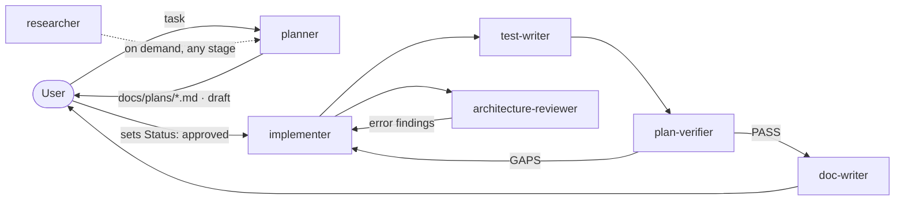

# Agents

Project subagents for DevDigest. Each `<name>.md` is a Claude Code subagent
(YAML frontmatter + system prompt). This README is a **map** of the set — who
does what, with which permissions, consuming and producing which artifacts.
The agent files themselves are the source of truth for their rules; read them
for the details.

Write scopes are enforced by a hook, not just by prompt text:
`.claude/hooks/guard.mjs <mode>` runs as a `PreToolUse` hook from each agent's
frontmatter (exit 2 = block, fail-closed). Its behaviour is pinned by
`node .claude/hooks/guard.selftest.mjs`.

## Workflow

The main session orchestrates: no agent spawns another (`Agent` is in every
agent's `disallowedTools`). `architecture-reviewer` and `plan-verifier` are
independent and can run in parallel. `researcher` is called whenever a plan
has `researcher:` open questions or external facts are needed.

## At a glance

| Agent | Responsibility | Model | Tools | Writes (guard mode) |
|---|---|---|---|---|
| [planner](planner.md) | Turns a task into a verifiable Development Plan, before any code | opus · effort high | Read, Grep, Glob, Write | `docs/plans/*.md` only (`planner`) |
| [implementer](implementer.md) | Executes an **approved** plan step by step, runs checks, self-checks its diff | sonnet | Read, Grep, Glob, Edit, Write, Bash, Skill | anything except protected paths (`implementer-files`); Bash denylist (`implementer-bash`) |
| [test-writer](test-writer.md) | Writes and runs Vitest tests from the plan/spec, not from the code | sonnet | Read, Grep, Glob, Edit, Write, Bash, Skill | test files + module `INSIGHTS.md`; new helpers create-only (`test-writer-files`); Bash: test runs + read-only git (`test-writer-bash`) |
| [architecture-reviewer](architecture-reviewer.md) | Checks architectural boundaries of a diff (rules AR-01…AR-16) | sonnet · effort high | Read, Grep, Glob, Bash | nothing; Bash: read-only git (`readonly-git`) |
| [plan-verifier](plan-verifier.md) | Traces every plan item to code/command evidence; finds untraced changes | sonnet · effort high | Read, Grep, Glob, Bash | nothing; Bash: read-only git + test/typecheck/e2e (`verifier-bash`) |
| [doc-writer](doc-writer.md) | Turns what was built into specs, ADRs, README sections, Mermaid diagrams | sonnet | Read, Grep, Glob, Edit, Write, Bash | `<module>/{docs,specs}/*.md`, `e2e/docs/*.md`, module/root `README.md`, `TESTING.md` (`doc-writer`); Bash: read-only git |
| [researcher](researcher.md) | Read-only repo and web research with cited evidence | sonnet | Read, Grep, Glob, WebSearch, WebFetch | nothing (no hook — no write tools, no Bash) |

Protected for every writing agent (`PROTECTED` in `guard.mjs`): `*/src/vendor/**`,
`server/src/db/migrations/**`, lock files, `server/clones/**`,
`server/package.json`, `docs/plans/**` (except planner), `.claude/**`.

## Inputs and outputs

| Agent | Input artifacts | Output artifacts | Result states |
|---|---|---|---|
| planner | task text; root + module `CLAUDE.md`, `INSIGHTS.md`, ADRs, specs, `.claude/skills/README.md`, code | `docs/plans/YYYY-MM-DD-<slug>.md` (`Status: draft`); short summary to the caller | — (or ≤ 4 clarifying questions) |
| implementer | plan with `Status: approved`; skills listed per step | code + tests in the plan's files; generated migration if schema changed; `INSIGHTS.md` lines; implementation report (steps, files, verification table, deviations, "for reviewers") | DONE · PARTIAL · BLOCKED |
| test-writer | approved plan, or a spec, or target + expected behaviour; implementer report | `*.test.ts(x)` / `*.it.test.ts`; `INSIGHTS.md` lines; test report (cases with source + red-check, commands, production bugs, not covered) | DONE · BUGS_FOUND · PARTIAL · BLOCKED |
| architecture-reviewer | base ref (default `main`); optional plan and implementer report | review report only (findings with severity · confidence, rule + its source, `file:line` evidence; pre-existing; unverified; rules checked) | PASS · FAIL |
| plan-verifier | approved plan; caller requirements (`R-n`); base ref; implementer/test-writer reports as leads | verification report only (traceability matrix per item, untraced changes, verification command results, decisions needed) | PASS · GAPS · NEEDS DECISION · BLOCKED |
| doc-writer | plan + plan-verifier report (PASS), or notes / spec draft / ADR request | specs, ADRs, README/TESTING.md updates with diagrams; docs report (files, diagrams, dropped items, plan-vs-code discrepancies) | DONE · PARTIAL · BLOCKED |
| researcher | a concrete question (repo, external, or mixed) | research report (TL;DR, conclusions with `path:line`/URL, conflicts, not found) | — (or clarifying questions) |

Plan status lifecycle: `draft` (planner) → `approved` (only the user) →
consumed by implementer, test-writer, plan-verifier, doc-writer.

## Where the rules come from

### planner

The agent does not cite sources itself; this maps its rules to what they rest on.

| Rule in `planner.md` | Source |
|---|---|
| Plan before code for multi-file / multi-module work; user approves the plan | Claude Code best practices — "Explore first, then plan, then code"; "Planning is most useful … when the change modifies multiple files" — https://code.claude.com/docs/en/best-practices |
| Plan is self-contained: files, out of scope, verification commands | Same page, "Let Claude interview you": "the most useful specs are self-contained: they name the files and interfaces involved, state what is out of scope, and end with an end-to-end verification step" |
| Evidence over memory — cite `path:line` | Same page, "Give Claude a way to verify its work": "show evidence rather than asserting success" |
| No external research; `researcher:` open questions | Clear task boundaries per worker — Anthropic, *How we built our multi-agent research system* — https://www.anthropic.com/engineering/multi-agent-research-system |
| Read skill frontmatter/headings, open a body only when a step needs it | Skills load on demand: "a skill's body loads only when it's used" — https://code.claude.com/docs/en/skills |
| Reading order; `INSIGHTS.md` is high-confidence | root `CLAUDE.md` "Read when"; each `<module>/CLAUDE.md` "Read when" |
| L02+ features are intentionally absent | root `CLAUDE.md:44`, `README.md:80-87` (lesson table) |
| Do-not-touch list; migrations via `pnpm db:generate`; no installs | root `CLAUDE.md:41-48`; `server/CLAUDE.md:32,41`; `server/docs/adr-002-manual-migrations.md` |
| Server module shape, schema-first routes, DI adapters + mocks | `server/CLAUDE.md:30,36,37`; `server/docs/adr-004-di-container-adapters.md` |
| reviewer-core purity, mandatory grounding gate | `reviewer-core/CLAUDE.md:32-33`; `server/docs/adr-005-mandatory-grounding-gate.md` |
| Client data via hooks → `api.ts`; component folders; tests mock `fetch` | `client/docs/adr-001-data-fetching-via-hooks.md`, `adr-003-component-folder-structure.md`, `adr-004-unit-tests-mock-fetch.md`; `client/CLAUDE.md` |
| Local intersection type instead of vendor edit; `.nullish()` fields | `server/INSIGHTS.md:10`; `client/INSIGHTS.md` (Codebase Patterns, 2026-09-20) |
| Invalidate list aggregates on mutation | `client/INSIGHTS.md:21` |
| Step → skill map | `.claude/skills/README.md` (catalog) |
| Verification commands per package | `TESTING.md:59-82` (Running locally, Conventions) |
| Only `docs/plans/*.md` is writable | `guard.mjs` mode `planner` |

### implementer

| Rule in `implementer.md` | Source |
|---|---|
| Only an approved plan; the plan is the contract; no silent deviation | Best practices — implement "verifying against its plan" after the Plan phase — https://code.claude.com/docs/en/best-practices |
| Baseline → change → re-run the same verification commands; report evidence | Best practices — "Give Claude a way to verify its work", "show evidence rather than asserting success", "the trust-then-verify gap" |
| Guarded paths/commands are hook-enforced; a block is final | Best practices, "Set up hooks": hooks are deterministic, CLAUDE.md is advisory; paths from root `CLAUDE.md:46-48`, `server/CLAUDE.md:41`; `guard.mjs` `PROTECTED` / `BANNED_CMDS` |
| No commits, no dependency installs, no DB migrate/seed | `guard.mjs` `BANNED_CMDS`; root `CLAUDE.md:41` (migrations are manual), "Do not touch" lock files |
| Load exactly the skills listed on each step; project rule beats skill rule | Skills docs (on-demand loading) — https://code.claude.com/docs/en/skills; module `CLAUDE.md` / ADRs as project conventions |
| Schema change ⇒ `pnpm db:generate`, include migration as-is | `server/CLAUDE.md:32`; `server/docs/adr-002-manual-migrations.md` |
| Tests colocated; DB tests `*.it.test.ts` | `TESTING.md:79-82`; `client/CLAUDE.md` naming conventions |
| Review scope = own diff; architecture/security by separate agents | Best practices — Writer/Reviewer pattern and "Add an adversarial review step" |
| Max 2 fix attempts per failure, then stop | By analogy with best practices "Correcting over and over … after two failed corrections" |
| Append insights to the module `INSIGHTS.md` | `.claude/skills/engineering-insights/SKILL.md`; every `<module>/CLAUDE.md` "Before you finish" |
| Preloaded `engineering-insights`; Skill tool with Read fallback | Sub-agents docs, `skills:` preload — https://code.claude.com/docs/en/sub-agents |

### test-writer, architecture-reviewer, plan-verifier, doc-writer

Designed from external research plus repo rules; the full source list
(Claude Code docs, Testing Trophy / RTL, Fastify testing, dependency-cruiser,
Nx, ts-arch, Next.js boundaries, requirements traceability, Diátaxis, ADR,
C4/arc42, Mermaid, LLM test-writing pitfalls) is in the **Sources** section of
[`docs/plans/2026-10-12-test-review-doc-subagents.md`](../../docs/plans/2026-10-12-test-review-doc-subagents.md).
Each agent's checklist cites the repo files its rules come from.

## Adding or changing an agent

1. Frontmatter: explicit `tools` **and** `disallowedTools` (an omitted `tools`
   inherits everything, MCP included); `Agent` always disallowed; no `memory:`
   on read-only agents (it grants Write/Edit). Unknown fields are ignored
   silently — check spelling.
2. Write scope → a `guard.mjs` mode (allowlist, deny by default) wired as a
   `PreToolUse` hook; add cases to `guard.selftest.mjs` and run it.
3. Keep `description` short and non-overlapping with the other agents —
   it drives automatic delegation.
4. New agents load at session start; frontmatter hooks run only in a trusted
   workspace.
5. Update this README.
